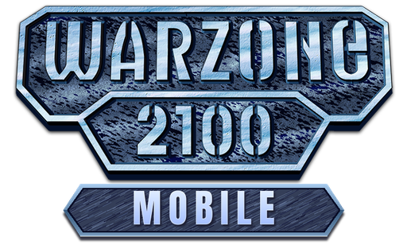

  

# Warzone2100 Mobile

A touch-friendly Android adaptation of [Warzone 2100](https://wz2100.net), the free and open-source real-time strategy game.

> **Unofficial.** Warzone2100 Mobile is an independent adaptation by MSJ Games. It is not made, endorsed or supported by the Warzone 2100 Project.

## What's different from the original

- **Touch-friendly main menu** for phones.
- **Local Player:** create or join a room over the same Wi-Fi or a phone hotspot, with automatic room discovery, one-tap join, a Refresh button and troubleshooting hints.
- **Thanks screen** crediting Pumpkin Studios, the Warzone 2100 Project team, and the artists, musicians, mappers, translators and testers.
- **Translations** of the new screens for 11 languages (Arabic, French, German, Spanish, Italian, Brazilian Portuguese, Russian, Turkish, Simplified Chinese, Korean, Polish).
- **Own branding:** name, launcher icon and version number. The app does not check the original project's servers for updates.

## Status

Early development. The Android code has not yet been tested on a wide range of devices. Bug reports are welcome.

## Building

See [BUILD_ANDROID.md](BUILD_ANDROID.md).

Requirements: JDK 17, Android SDK and NDK, CMake, Ninja. The game data files (`base.wz` and others) are not part of this source tree.

Release signing: copy `platforms/android/keystore.properties.example` to `keystore.properties` and fill it in. **Never commit `keystore.properties` or a `.jks` file.**

## Changes

A detailed list of every change is in [platforms/android/CHANGES_AR.md](platforms/android/CHANGES_AR.md) (Arabic).

## Source

https://github.com/asdbrg854-netizen/Warzone2100-Mobile

## License

Warzone 2100 is free software under the **GNU General Public License v2 or later**. This adaptation is distributed under the same license. See [COPYING](COPYING), [COPYING.NONGPL](COPYING.NONGPL) (licenses of artwork, music and third-party code) and [AUTHORS](AUTHORS).

## Credits

Thanks to Pumpkin Studios for the original game, to the Warzone 2100 Project and all its contributors, and special thanks to Jouri.

## Support

If you enjoy the app you can support the developer on Ko-fi: https://ko-fi.com/msj5gr

---

Made by **MSJ Games**.
